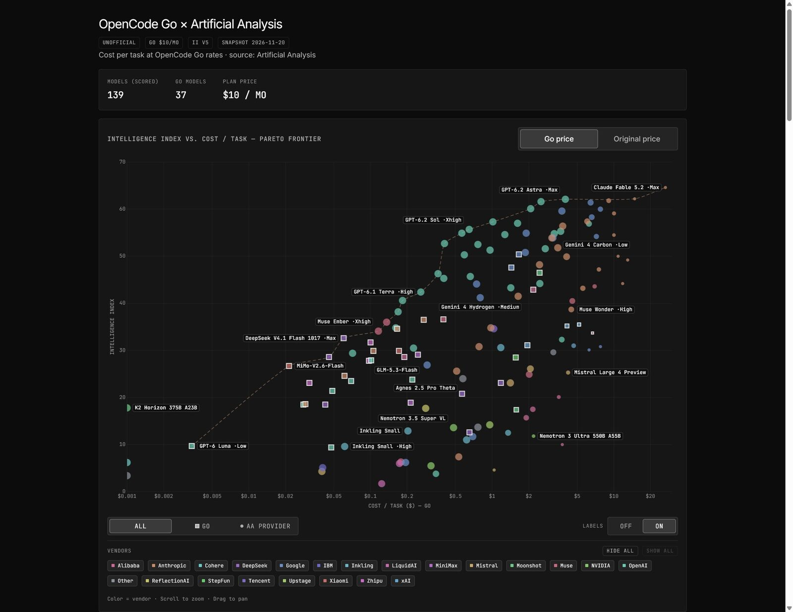

# OpenCode Go × Artificial Analysis — cost per task

Cost per task for every model on OpenCode Go pricing, with DeepSeek at both peak
and off-peak rates, plus a Go costs & workload calculator with raw input,
cache-read and output prices.

Fork of [xhang1108/opencode-cost-per-intelligence](https://github.com/xhang1108/opencode-cost-per-intelligence).

## What this fork adds

- **Go calculator (Per 1M tokens tab).** A second table prices a token workload on the
  Go ($10) plan: input, cache-read and output $/1M, workload cost, pro-rata sub cost,
  % of allowance, blocks per subscription and max tokens per subscription. Prices and
  allowances are fetched live from `https://opencode.ai/inference/go/v1/models`.
- **Tabs — Per task / Per 1M tokens.** "Per task" holds the AA chart and model table,
  opening on the Go subset (All and AA provider are one click away); "Per 1M tokens"
  holds the Go calculator. One lens at a time instead of one long scroll, with the
  active tab kept in the URL hash.
- **Go chart.** Intelligence Index vs the Sub cost of the current workload (the share
  of the Go plan it uses, the table's Sub cost column and default sort) for every Go
  model with an AA score, driven by the calculator's tokens / cache-hit / output inputs.
  Sub cost folds in each model's allowance, so a bigger allowance can beat a lower
  list price; free models sit at the left edge. Over-allowance rows get an orange ring.
- **Labels Off / Auto / All** on both charts (each chart has its own switch). Auto avoids overlaps. All removes the density thinning,
  shrinks the font and grows the chart, labelling every model that fits without a
  collision; zoom in to label the rest. With 148 rows there is no readable all-at-once
  layout, so the table remains the complete list.
- **Models filter.** Auto, the default, keeps one run per model and hides the rest: inside a
  single model a variant is hidden when another effort of the same model is at least as smart
  for no more money, so peak rows lose to their off-peak twins and Max beats High and
  Non-reasoning. Every model stays on the chart with its best run. The list groups the full
  model names and shows each model's own effort chips, so a variant can be re-enabled one
  model at a time; Enable all, Disable all and Auto cover the rest. Auto is recomputed when
  the Go / All / AA source or the Go / Original price changes, and both charts follow it.
  Rows Auto hides only stay out of the Per task view: the Go chart still reads their AA
  scores, and falls back to the next effort run only when you hide a variant yourself.
- **Pareto frontier.** The dashed orange line is drawn from every row of the current source,
  not just the visible ones, and carries its own "Pareto frontier" label on both charts. It
  therefore stays on the chart while variants are hidden, including with every model
  disabled. The axes fit the selected source, so the Go view fills the plot instead of
  leaving it half empty.
- **Phone layout.** Tabs keep one section on screen; charts keep a readable height and
  support pinch or scroll to zoom and drag to pan, with − / + / Reset buttons.
- **DeepSeek peak and off-peak.** Every DeepSeek row appears twice: the AA row at peak
  rates and an off-peak twin at half price. Off-peak tasks also consume half the Go
  allowance, so the Go effective prices halve too.
- **Correction to the premise.** AA prices DeepSeek at **peak**, not off-peak. AA's own
  cost breakdown for V4.1 Flash (Max) is 174.36M output tokens × $1.20/M = $209.23,
  exactly its published output cost; $1.20 is the peak output rate (off-peak is $0.60).
  The page therefore labels the AA row Peak and the twin Off-peak. Peak hours are
  01:00–04:00 and 06:00–10:00 UTC, Monday–Friday, excluding Chinese public holidays.

## Data

| File | Content |
|---|---|
| `data/aa-models.json` | Intelligence Index, cost per task, output tok/s — Artificial Analysis free API |
| `data/go-limits.json` | Go monthly allowance per model, plus `contributor` / `limited_regions` flags |
| `data/go-models.json` | Daily snapshot of the live OpenCode Go models endpoint; also the browser's fallback, and the source of the reasoning efforts `build.py` uses for the ≤ rule |
| `data/merged.json` | Joined rows + `snapshot_date`, from `python build.py` |

AA scores are a snapshot; Go prices and allowances are live in the browser (one-hour
cache) with `data/go-models.json` as the fallback. Current numbers:
[Intelligence Index](https://artificialanalysis.ai/evaluations/artificial-analysis-intelligence-index) ·
[Go pricing](https://opencode.ai/console/go)

## Method

| Metric | Formula |
|---|---|
| Go $/task | AA $/task × $10 ÷ monthly allowance |
| Contributor $/task | AA $/task × 0.0531 (contributor ÷ standard blended price, 7:2:1) × $10 ÷ monthly allowance |
| DeepSeek off-peak | peak × 0.5 for cost/task and the Go effective price |
| Two rows | A model AA has measured and Go sells in both modes is listed twice: standard and Go Contributor (or Beam's free tier) |
| Go free tier | $0/task, no monthly allowance (limited regions, limited time, daily request cap) |
| $/point | Go $/task ÷ Intelligence Index |
| Tasks per $10 | monthly allowance ÷ AA $/task |
| Go workload cost | fresh input × input + cached input × cache-read + output × output |
| Sub cost | workload cost ÷ allowance × plan price |
| Blocks / sub | allowance ÷ workload cost |
| Max tokens / sub | allowance ÷ blended $/1M at your mix |

One model at a time: assumes the whole allowance is spent on that model, and unused
allowance does not roll over. The Go calculator's total tokens split into input and
output by output %, and input splits into fresh and cached by the cache-hit rate.

## Refresh

`python scripts/fetch_aa.py` needs an `AA_API_KEY` repo secret; the cron only needs that
secret for AA scores. The scheduled workflow skips the AA fetch and rebuilds from the
committed snapshot when the secret is absent, so a fork without the secret keeps working.

The Action also runs `python scripts/fetch_go_models.py` daily, so `data/go-models.json`
stays current. The Go costs table fetches prices and allowances live on load and caches
them for an hour, falling back to that file when the endpoint is unreachable; allowances
are applied live in the browser. `build.py` reads the file's reasoning efforts to mark a
score as an upper bound when AA has not measured the effort Go sells.

To refresh the fallback by hand, run `python scripts/fetch_go_models.py`.

Unofficial; not affiliated with OpenCode / SST.
